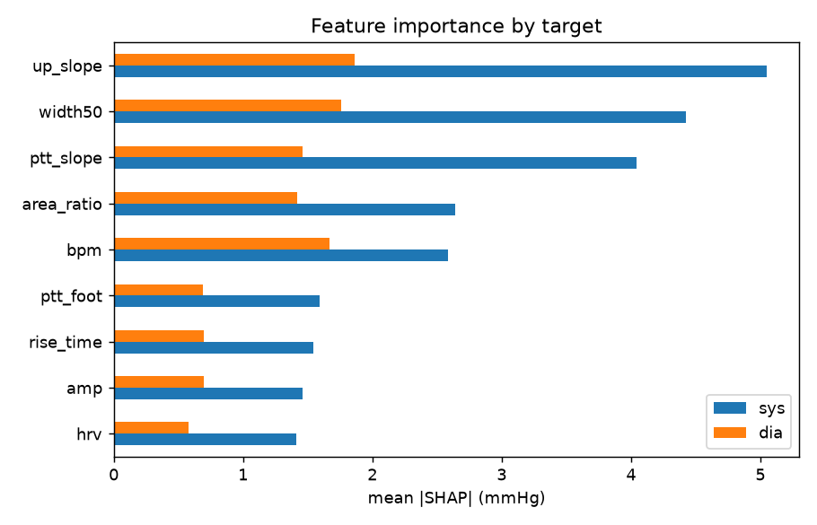

# PulseTrace

Predicting blood pressure (systolic and diastolic) from a PPG pulse signal, with ECG as an extra input. The project is mostly about **evaluating honestly**: the first results looked good, and they were wrong.

## Summary

- **Task:** predict systolic (SBP) and diastolic (DBP) blood pressure for each 30 s window of PPG and ECG, with invasive arterial pressure (ABP) used only to build the labels.
- **Features:** heart rate, pulse transit time (PTT, the delay from the ECG R-peak to the PPG pulse), and the shape of each PPG pulse (rise time, upstroke slope, width, area ratio).
- **Final result:** when predicting for files the model has never seen, SBP error falls by about **1.6 mmHg (roughly 9%) versus always guessing the mean**, and the model beats the mean on 10 of 12 files. DBP shows no meaningful gain.
- **This is not clinically useful.** The SBP error SD is about 20 mmHg, against a limit of 8 mmHg in the AAMI standard.
- **The main lesson:** a validation scheme that let the same patient appear in training and validation reported SBP R² of 0.40. The same model scored 0.02 once whole files were held out.

## Data

12 MATLAB files (`data/part_1.mat` to `part_12.mat`), each holding 1,000 records of simultaneous PPG, ABP and ECG at 125 Hz. Records range from about 8 seconds to 10 minutes. The data appears to be the public Cuffless Blood Pressure Estimation dataset, but I have not verified its provenance. The files are not in this repo.

There are **no patient IDs**, so I cannot guarantee that two records come from different people. This shapes the whole evaluation (see below).

## Pipeline

1. **Windows.** Each record is split into 30 s windows (83,423 windows from 9,624 records of at least 30 s). The BP label for a window is the median ABP peak (systolic) and trough (diastolic), set to missing for flat-lined or physiologically implausible windows.
2. **Signal cleaning.** PPG is bandpass-filtered (0.5 to 8 Hz, zero-phase, so it adds no delay that would bias PTT). Beats are found using prominence, not just spacing.
3. **Features per window** (median over the window's beats):
   - heart rate and its variability
   - **PTT**: each ECG R-peak is matched to the next PPG foot in time, with two landmarks (the foot and the steepest point of the upstroke)
   - **pulse shape**: amplitude, rise time, upstroke slope, width at half height, systolic area ratio
   - a signal-quality score (kept as a diagnostic; filtering on it changed nothing)
4. **Models.** Ridge, random forest and XGBoost, all tracked in MLflow.

The 80,315 windows from 9,379 records that have every feature are used for modelling.

## What I found

### 1. Heart rate alone predicts nothing
Using only heart rate and its variability gives SBP R² of about 0.00. This is the baseline everything else is compared with.

### 2. Better beat detection mattered more than filtering
Checking PPG heart rate against the heart rate from the ABP beats on 360 random records: raw peak-finding had an error of 7.5 bpm. Adding prominence (on a normalised signal) cut it to 2.1 bpm. The bandpass filter on its own helped less (5.3 bpm); prominence did most of the work. The filter still matters for the PTT and pulse-shape features, which depend on exact beat timing.

### 3. PTT and pulse shape looked like a big win, but it was leakage
With validation folds that kept each **record** together, XGBoost reached SBP R² of 0.40. A single check on files held out whole told a different story:

| Same XGBoost model, SBP | R² |
|---|---|
| Validation grouped by record | 0.40 |
| Validation grouped by source file | 0.02 |
| Scored once on held-out files (parts 11 and 12) | 0.08 |

Records from the same patient are near-duplicates, so the model was partly recognising people, not learning blood pressure. I switched all validation to hold out **whole files**, which is the closest available stand-in for "a new patient".

### 4. Final evaluation: leave-one-file-out
Each of the 12 files is held out in turn and predicted by a model trained on the other 11. "Gain" is the mean absolute error of always guessing the training mean minus the model's, in mmHg, averaged over files (± the spread across files).

| Model | SBP gain | Files better than the mean | DBP gain |
|---|---|---|---|
| Ridge, heart rate only | +0.12 ± 0.47 | 6 / 12 | +0.17 |
| Ridge, all features | +0.71 ± 1.40 | 9 / 12 | +0.36 |
| Random forest, all features | +1.10 ± 2.03 | 10 / 12 | +0.14 |
| **XGBoost (depth 3), all features** | **+1.61 ± 2.33** | **10 / 12** | +0.27 |

Fold-to-fold noise is large, so the gaps between the top models are not reliable. What is reliable: PTT and pulse shape help, and the effect is small.

### 5. What drives the predictions
SHAP shows `up_slope` (steepness of the pulse upstroke), `width50` and `ptt_slope` as the strongest features. `ptt_slope` has the textbook direction: a shorter transit time pushes predicted SBP up.



### 6. One file where the model gets worse than guessing
On `part_5` the model is worse than the mean (SBP error +4.7 mmHg *higher*). Its predictions are negatively correlated with the truth there. Across the other 11 files, `ptt_slope` correlates negatively with SBP in every one (about -0.25), but in part 5 the correlation is about zero. `width50` also behaves unusually there (a negative correlation, strongest for DBP, where the other files are near zero). Part 5's pulse waveforms are also systematically different. I could not tell whether this is a different patient mix, a different sensor or a timing offset, because the data carries no metadata.

### 7. Restricting to "stable" features trades accuracy for safety
Inside every fold, I kept only features whose correlation with BP kept the same sign across the training files (rule fixed in advance, held-out file never used). For the ridge models this cut the worst-file loss (part 5) from -4.7 to about -1.0 mmHg and shrank the spread across files, but selection also lowered the average SBP gain from +1.6 to about +0.5 to +0.7. It is a trade-off, not a free improvement.

## Limitations

- **No patient IDs.** Leaving out whole files reduces patient overlap but cannot guarantee it is gone. The results may still be slightly optimistic.
- **The model mostly captures a record's typical BP level, not changes within it.** Within a single record, predictions correlate with the true BP at only about 0.12 to 0.16, and BP barely moves within a few minutes (SD about 5 mmHg).
- **Not accurate enough for clinical use.** The SBP error SD is about 20 mmHg (AAMI limit: 8). The AAMI check here is also applied per window, so it is only an approximation of the real procedure.
- **One population.** If the recordings are ICU monitor data, as they appear to be, they come from sick patients and do not represent a general population.
- **Light tuning.** A small number of XGBoost settings were compared, chosen by cross-validation. The single held-out test run used a model picked under the leaky validation scheme, so I treat leave-one-file-out as the reliable number.
- **Possible future work:** features relative to each person's own baseline (needs a calibration period), and a 1D CNN on the raw waveform.

## Reproduce

Everything runs in Docker (Python 3.11). Place the 12 `.mat` files in `data/`, then:

```bash
docker compose up -d
docker compose exec pipeline python -m src.features.make_dataset   # parse once, cache features (a few minutes)
docker compose exec pipeline python -m pytest -q tests
docker compose exec pipeline python -m src.run_lofo                # leave-one-file-out comparison
docker compose exec pipeline python -m src.run_stability          # stable-feature experiment
docker compose exec pipeline python -m src.explain                 # SHAP figures
```

MLflow runs are tracked at http://localhost:5001. `docker-compose.yml` mounts `~/.kaggle/kaggle.json`; remove that line if you do not use Kaggle.

## Layout

```
src/features/build_features.py   beat detection, PTT, pulse-shape features, window labels
src/features/make_dataset.py     parse all files once, cache to data/features.parquet
src/evaluation.py                grouped CV, leave-one-file-out, within-record check, metrics
src/run_ladder.py                model and feature-set comparison (logged to MLflow)
src/run_lofo.py                  final leave-one-file-out comparison
src/run_stability.py             stable-feature selection experiment
src/final_eval.py                single held-out scoring (parts 11 and 12)
src/explain.py                   SHAP figures
tests/                           unit tests for features and the evaluation protocol
Notebooks/01_eda.ipynb           exploration (paired with a .py via jupytext)
```
